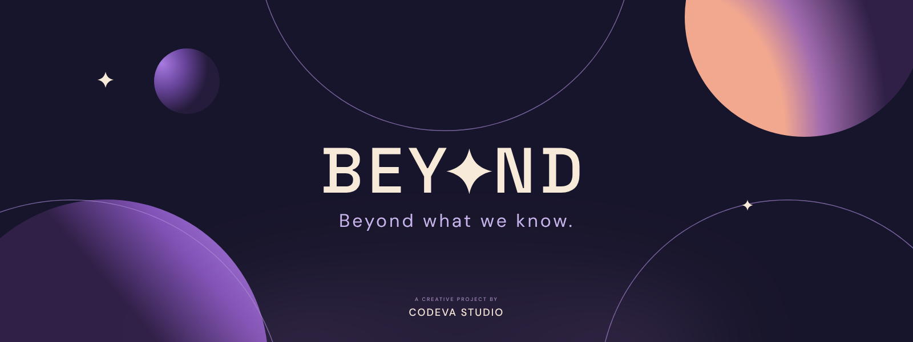
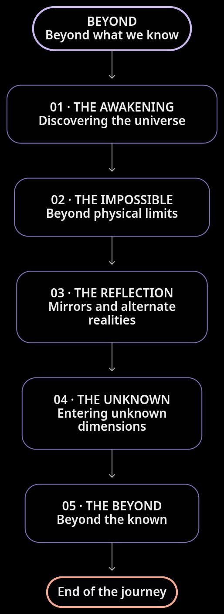
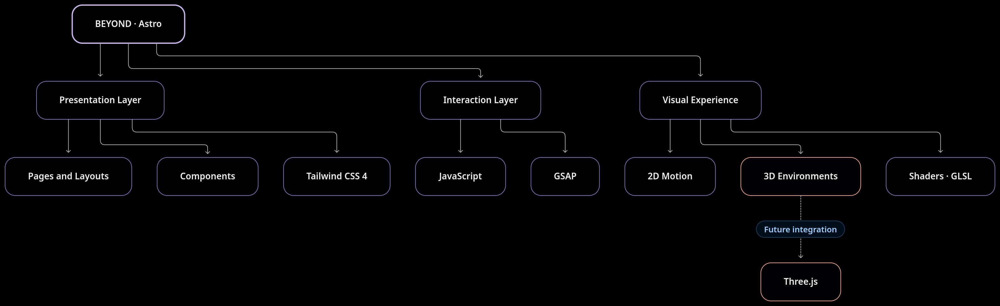

# BEYOND

  

  
  

<h1 align="center">BEYOND</h1>

  <strong>Más allá de lo que conocemos.</strong>

  Una exploración de la percepción, los espacios imposibles y las dimensiones imaginarias.

  
  
  
  

  
  
  

---

## Contenido

- [Acerca del proyecto](#acerca-del-proyecto)
- [Fundamentos conceptuales](#fundamentos-conceptuales)
  - [01. Psicología de la Gestalt](#01-psicología-de-la-gestalt)
  - [02. Geometría imposible](#02-geometría-imposible)
  - [03. Percepción y realidad](#03-percepción-y-realidad)
- [La experiencia](#la-experiencia)
- [Vista previa de la experiencia](#vista-previa-de-la-experiencia)
- [Dirección visual](#dirección-visual)
- [Tecnologías](#tecnologías)
- [Arquitectura del proyecto](#arquitectura-del-proyecto)
- [Desarrollo](#desarrollo)
- [Estado del proyecto](#estado-del-proyecto)
- [Hoja de ruta](#hoja-de-ruta)
- [Referencias](#referencias)

---

## Acerca del proyecto

**¿Qué sucede cuando aquello que vemos desafía lo que creemos posible?**

BEYOND es una experiencia digital experimental que explora los límites entre la percepción, la geometría y la imaginación.

Inspirado en principios reales de percepción visual y paradojas matemáticas, el proyecto transforma estructuras imposibles, entornos surrealistas e ilusiones espaciales en un recorrido visual interactivo.

Combina programación creativa, arquitectura digital, animación y narrativa visual para cuestionar la forma en que interpretamos los espacios que nos rodean.

## Fundamentos conceptuales

La experiencia toma inspiración de conceptos relacionados con la psicología, la geometría y la investigación visual.

### 01. Psicología de la Gestalt

La psicología de la Gestalt estudia cómo la mente humana organiza la información visual en patrones, estructuras y conjuntos con significado.

Principios como la proximidad, la semejanza, la continuidad y el cierre influyen en la manera en que percibimos las formas y las relaciones espaciales.

BEYOND explora estos principios mediante composiciones que desafían las expectativas visuales e invitan a reconsiderar aquello que percibimos.

### 02. Geometría imposible

Las figuras imposibles son representaciones visuales que parecen describir estructuras tridimensionales coherentes, pero contienen relaciones espaciales que no pueden existir tal como se muestran.

Un ejemplo conocido es el triángulo de Penrose, presentado en el trabajo de Lionel y Roger Penrose en 1958.

Estas construcciones muestran la diferencia entre una representación visual y la posibilidad física de aquello que representa.

BEYOND utiliza la geometría imposible como inspiración para crear formas arquitectónicas, perspectivas inusuales y entornos que desafían la lógica espacial convencional.

### 03. Percepción y realidad

La percepción humana no es una simple reproducción del mundo. Implica interpretar la información visual y construir una comprensión de nuestro entorno.

A través de reflejos, perspectivas, escalas y ambigüedades visuales, BEYOND explora la relación entre lo que se presenta ante nuestros ojos y lo que nuestra mente interpreta.

### De la teoría a la experiencia

Estos conceptos funcionan como fundamento intelectual de una exploración artística, no como simulaciones científicas.

El proyecto transforma ideas de la percepción visual y la geometría en entornos interactivos donde la arquitectura, el movimiento y la perspectiva se convierten en herramientas narrativas.

---

## La experiencia

BEYOND se desarrolla a través de cinco capítulos conectados entre sí. Cada uno representa una etapa diferente en la exploración de espacios desconocidos.

### Recorrido de la experiencia

  

### 01 — The Awakening

**El comienzo de la percepción.**

Una introducción a un universo desconocido donde los límites de lo conocido comienzan a desvanecerse.

### 02 — The Impossible

**Más allá de la lógica espacial.**

Una exploración de arquitecturas imposibles, estructuras poco convencionales y perspectivas que desafían las reglas del espacio físico.

### 03 — The Reflection

**Una versión diferente de la realidad.**

Espejos, reflejos y distorsiones visuales crean entornos donde la relación entre la realidad y su representación se vuelve incierta.

### 04 — The Unknown

**Más allá de las dimensiones conocidas.**

Un encuentro con entornos desconocidos, portales y espacios que invitan a explorar más allá de las representaciones espaciales convencionales.

### 05 — The Beyond

**Más allá de los límites de la percepción.**

La etapa final del recorrido, donde la imaginación y la percepción convergen en una experiencia sin límites claramente definidos.

---

## Vista previa de la experiencia

Un vistazo a los entornos, las secuencias de movimiento y los experimentos visuales que dan forma a BEYOND.

<!--

  

-->

---

## Dirección visual

El lenguaje visual de BEYOND se construye a partir de entornos surrealistas, arquitecturas imposibles y composiciones cinematográficas.

Su estética combina:

- Paisajes oníricos y entornos atmosféricos.
- Estructuras geométricas y paradojas espaciales.
- Reflejos, distorsiones e ilusiones ópticas.
- Profundidad, luz y movimiento.
- Transiciones experimentales entre entornos.

### Paleta de colores

| Color | Código hexadecimal | Uso |
|---|---|---|
| Midnight | `#17152B` | Fondo principal |
| Violet | `#8274B9` | Acento principal |
| Lilac | `#C8B6ED` | Acento secundario |
| Peach | `#F2A88F` | Acento cálido |
| Ivory | `#F8EAD9` | Texto claro y contraste |
| Aqua | `#8EDCE0` | Acento complementario |

La dirección visual busca construir un universo coherente, en lugar de presentar una colección de animaciones sin relación entre sí.

## Tecnologías

El proyecto combina tecnologías web modernas con herramientas de desarrollo creativo.

| Tecnología | Función | Estado |
|---|---|---|
| Astro | Estructura del proyecto y framework web | Instalado |
| Tailwind CSS 4 | Estilos y diseños adaptables | Configurado |
| JavaScript | Comportamiento interactivo | Planificado |
| GSAP | Diseño de movimiento y secuencias de animación | Instalado |
| Three.js | Entornos 3D y renderizado en tiempo real | Planificado |

  
  
  
  

## Arquitectura del proyecto

La experiencia se organiza mediante una estructura modular que separa los componentes visuales, las páginas, los contenidos, los scripts y los estilos.

  

## Desarrollo

BEYOND se desarrolla progresivamente, combinando investigación conceptual, experimentación visual e ingeniería de software.

El proceso de desarrollo se organiza en las siguientes etapas:

1. Investigación conceptual y arquitectura del proyecto.
2. Identidad visual y diseño de entornos.
3. Implementación de la experiencia interactiva.
4. Animación y experimentación espacial.
5. Optimización del rendimiento, la accesibilidad y la adaptación a diferentes dispositivos.

## Estado del proyecto

  

El proyecto se encuentra actualmente en su etapa inicial. Ya se han establecido su dirección conceptual y su entorno técnico. La identidad visual, los entornos interactivos y los capítulos narrativos se implementarán progresivamente.

## Hoja de ruta

- [x] Inicializar el proyecto con Astro.
- [x] Configurar Tailwind CSS 4.
- [x] Instalar GSAP.
- [ ] Establecer la arquitectura del proyecto.
- [ ] Definir la identidad visual.
- [ ] Desarrollar la experiencia principal.
- [ ] Crear los cinco capítulos narrativos.
- [ ] Implementar animaciones interactivas.
- [ ] Explorar entornos 3D con Three.js.
- [ ] Implementar soporte para inglés y español.
- [ ] Optimizar el rendimiento y la adaptación a diferentes dispositivos.
- [ ] Publicar la experiencia final.

## Referencias

La dirección conceptual de BEYOND toma como referencia las siguientes publicaciones y recursos:

1. Penrose, L. S., & Penrose, R. (1958). *Impossible Objects: A Special Type of Visual Illusion*. British Journal of Psychology, 49(1), 31–33. [https://doi.org/10.1111/j.2044-8295.1958.tb00634.x](https://doi.org/10.1111/j.2044-8295.1958.tb00634.x)
2. OpenStax. *Psychology 2e — Gestalt Principles of Perception*. [Consultar la referencia](https://openstax.org/books/psychology-2e/pages/5-6-gestalt-principles-of-perception)

---

  <strong>BEYOND</strong>
   
  <em>Más allá de lo que conocemos.</em>

