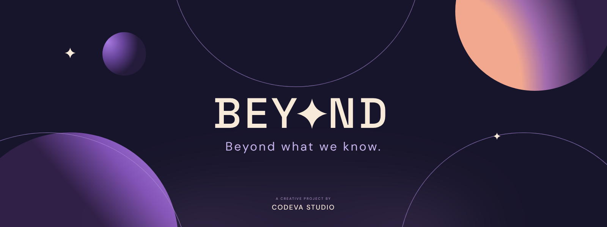
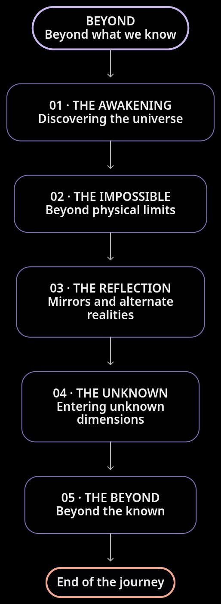
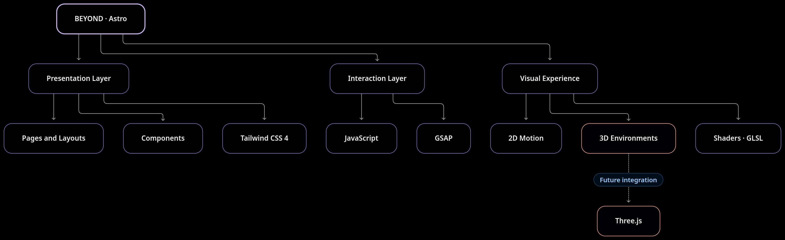

# BEYOND

  

  
  

<h1 align="center">BEYOND</h1>

  <strong>Beyond what we know.</strong>

  An exploration of perception, impossible spaces and imaginary dimensions.

  
  
  
  

  
  
  

---

## Contents

- [About the Project](#about-the-project)
- [Conceptual Foundation](#conceptual-foundation)
  - [01. Gestalt Psychology](#01-gestalt-psychology)
  - [02. Impossible Geometry](#02-impossible-geometry)
  - [03. Perception and Reality](#03-perception-and-reality)
- [The Experience](#the-experience)
- [Experience Preview](#experience-preview)
- [Visual Direction](#visual-direction)
- [Technology](#technology)
- [Project Architecture](#project-architecture)
- [Development](#development)
- [Project Status](#project-status)
- [Roadmap](#roadmap)
- [References](#references)

---

## About the Project

**What happens when what we see challenges what we believe to be possible?**

BEYOND is an experimental digital experience that explores the boundaries between perception, geometry and imagination.

Inspired by real principles of visual perception and mathematical paradoxes, the project transforms impossible structures, surreal environments and spatial illusions into an interactive visual journey.

It brings together creative coding, digital architecture, animation and visual storytelling to question how we interpret the spaces around us.

## Conceptual Foundation

The experience draws inspiration from concepts in psychology, geometry and visual research.

### 01. Gestalt Psychology

Gestalt psychology examines how the human mind organizes visual information into patterns, structures and meaningful wholes.

Principles such as proximity, similarity, continuity and closure influence how we perceive shapes and spatial relationships.

BEYOND explores these principles through compositions that challenge visual expectations and encourage visitors to reconsider what they perceive.

### 02. Impossible Geometry

Impossible figures are visual representations that appear to describe coherent three-dimensional structures but contain spatial relationships that cannot exist as depicted.

One notable example is the Penrose triangle, introduced in the work of Lionel and Roger Penrose in 1958.

These constructions reveal the difference between visual representation and physical possibility.

BEYOND uses impossible geometry as inspiration for architectural forms, unusual perspectives and environments that challenge conventional spatial logic.

### 03. Perception and Reality

Human perception is not a passive recording of the world. It involves interpreting visual information and constructing an understanding of our surroundings.

Through reflections, perspective, scale and visual ambiguity, BEYOND explores the relationship between what is presented to the eye and what the mind understands.

### From Theory to Experience

These concepts serve as the intellectual foundation of an artistic exploration, not as scientific simulations.

The project translates ideas from visual perception and geometry into interactive environments where architecture, motion and perspective become tools for storytelling.

---

## The Experience

BEYOND unfolds through five interconnected chapters. Each one represents a different stage in the exploration of unfamiliar spaces.

### Experience Flow

  

### 01 — The Awakening

**The beginning of perception.**

An introduction to an unfamiliar universe where the boundaries of the known begin to dissolve.

### 02 — The Impossible

**Beyond spatial logic.**

An exploration of impossible architecture, unconventional structures and perspectives that challenge the rules of physical space.

### 03 — The Reflection

**A different version of reality.**

Mirrors, reflections and visual distortions create environments where the relationship between reality and representation becomes uncertain.

### 04 — The Unknown

**Beyond familiar dimensions.**

An encounter with unfamiliar environments, portals and spaces that invite exploration beyond conventional spatial representation.

### 05 — The Beyond

**Beyond the limits of perception.**

The final stage of the journey, where imagination and perception converge into an experience without a clearly defined boundary.

---

## Experience Preview

A glimpse into the environments, motion sequences and visual experiments that shape BEYOND.

<!--

  

-->

---

## Visual Direction

The visual language of BEYOND is built around surreal environments, impossible architecture and cinematic compositions.

Its aesthetic combines:

- Dreamlike landscapes and atmospheric environments.
- Geometric structures and spatial paradoxes.
- Reflections, distortions and optical illusions.
- Depth, light and movement.
- Experimental transitions between environments.

### Color Palette

| Color | Hex | Role |
|---|---|---|
| Midnight | `#17152B` | Primary background |
| Violet | `#8274B9` | Main accent |
| Lilac | `#C8B6ED` | Secondary accent |
| Peach | `#F2A88F` | Warm accent |
| Ivory | `#F8EAD9` | Light text and contrast |
| Aqua | `#8EDCE0` | Additional accent |

The visual direction aims to create a cohesive universe rather than a collection of unrelated animations.

## Technology

The project combines modern web technologies with creative development tools.

| Technology | Purpose | Status |
|---|---|---|
| Astro | Project structure and web framework | Installed |
| Tailwind CSS 4 | Styling and responsive layouts | Configured |
| JavaScript | Interactive behavior | Planned |
| GSAP | Motion design and animation sequences | Installed |
| Three.js | 3D environments and real-time rendering | Planned |

  
  
  
  

## Project Architecture

The experience is organized around a modular structure that separates visual components, page layouts, content, scripts and styles.

  

## Development

BEYOND is being developed progressively, combining conceptual research, visual experimentation and software engineering.

The development process is organized around:

1. Conceptual research and project architecture.
2. Visual identity and environment design.
3. Implementation of the interactive experience.
4. Animation and spatial experimentation.
5. Performance, accessibility and responsive optimization.

## Project Status

  

The project is currently in its foundational stage. Its conceptual direction and initial technical environment have been established. The visual identity, interactive environments and narrative chapters will be implemented progressively.

## Roadmap

- [x] Initialize the Astro project.
- [x] Configure Tailwind CSS 4.
- [x] Install GSAP.
- [ ] Establish the project architecture.
- [ ] Define the visual identity.
- [ ] Develop the main experience.
- [ ] Create the five narrative chapters.
- [ ] Implement interactive animations.
- [ ] Explore 3D environments with Three.js.
- [ ] Implement English and Spanish support.
- [ ] Optimize performance and responsiveness.
- [ ] Publish the final experience.

## References

The conceptual direction of BEYOND is informed by the following publications and resources:

1. Penrose, L. S., & Penrose, R. (1958). *Impossible Objects: A Special Type of Visual Illusion*. British Journal of Psychology, 49(1), 31–33. [https://doi.org/10.1111/j.2044-8295.1958.tb00634.x](https://doi.org/10.1111/j.2044-8295.1958.tb00634.x)
2. OpenStax. *Psychology 2e — Gestalt Principles of Perception*. [Read the reference](https://openstax.org/books/psychology-2e/pages/5-6-gestalt-principles-of-perception)

---

  <strong>BEYOND</strong>
   
  <em>Beyond what we know.</em>

